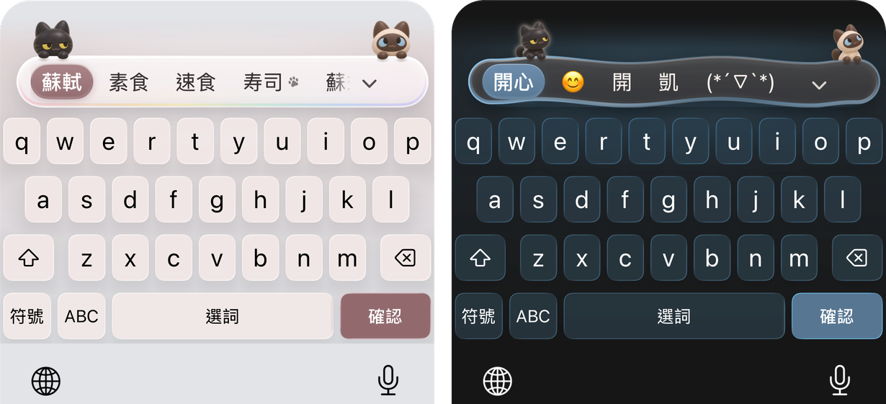
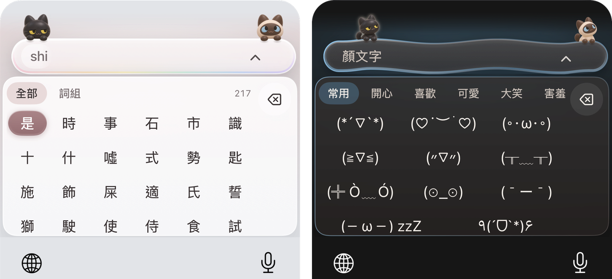
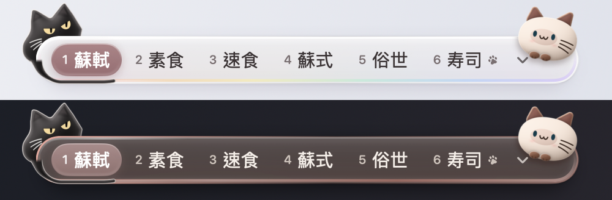

<p align="center">
  
</p>

<h1 align="center">喵撲 Meowpuut</h1>
<p align="center">注音和拼音輸入法。中文裡要打日文詞，不用切換。</p>
<p align="center">
  <a href="#下載">下載</a> ·
  <a href="docs/INSTALL.md">安裝說明</a> ·
  <a href="https://github.com/Krysta1ll/Meowpuut/issues">回報問題</a>
</p>


喵撲可以打注音和拼音，出繁體或簡體。中文打到一半想放一個日文詞，直接打羅馬字：打 `sushi`，候選裡帶貓爪的「寿司」就是日文。英文也直接夾在拼音裡打：`wozaiyongiphone` 是「我在用iPhone」。

候選列是一條玻璃。黑色的米米莫和奶油色的莫莫把前爪搭在上面。

主要做的是 iPhone 和 iPad 的鍵盤，Mac、Android、Windows 也有。0.8.0 是四個平台第一次一起發布，都還是測試版。



## 下載

| 平台 | 版本 | 下載 |
| --- | --- | --- |
| iPhone、iPad（iOS 17 以上） | 0.8.0（9） | [TestFlight](https://testflight.apple.com/join/kfMVXAC6) |
| Mac（macOS 27 以上，Apple 晶片） | 0.8.0 Alpha 1 | [安裝盤 .dmg](https://github.com/Krysta1ll/Meowpuut/releases/download/v0.8.0-alpha.1/Meowpuut-0.8.0-alpha.1-macos-arm64.dmg) · [安裝套件 .pkg](https://github.com/Krysta1ll/Meowpuut/releases/download/v0.8.0-alpha.1/Meowpuut-0.8.0-alpha.1-macos-arm64.pkg) |
| Android（8.0 以上） | 0.8.0 Alpha 1 | [APK](https://github.com/Krysta1ll/Meowpuut/releases/download/v0.8.0-alpha.1/Meowpuut-0.8.0-alpha.1-android.apk) |
| Windows 10、11 | 0.8.0 Alpha 1 | [x64 zip](https://github.com/Krysta1ll/Meowpuut/releases/download/v0.8.0-alpha.1/Meowpuut-0.8.0-alpha.1-windows-x64.zip) · [Arm64 zip](https://github.com/Krysta1ll/Meowpuut/releases/download/v0.8.0-alpha.1/Meowpuut-0.8.0-alpha.1-windows-arm64.zip) |

下載的檔案可以用 [SHA256SUMS.txt](https://github.com/Krysta1ll/Meowpuut/releases/download/v0.8.0-alpha.1/SHA256SUMS.txt) 核對。舊版本在 [Releases](https://github.com/Krysta1ll/Meowpuut/releases)。

- **iPhone、iPad**：先從 App Store 安裝 Apple 的 TestFlight，再用手機打開 [TestFlight 連結](https://testflight.apple.com/join/kfMVXAC6)，安裝喵撲。裝好後到「設定 → 一般 → 鍵盤 → 鍵盤 → 新增鍵盤」加入喵撲。不用打開「允許完整取用」。
- **Mac**：沒有經過 Apple 公證，第一次打開可能被系統擋下，請先讀[安裝說明](docs/INSTALL.md#mac)。裝好要登出再登入，再到系統設定加入輸入法。
- **Android**：這一版換了簽署用的金鑰。裝過 0.1.0 的話，要先移除舊的，新的才裝得上。
- **Windows**：沒有簽署的測試版，Windows 可能會先跳出警告。一般電腦用 x64；Arm 處理器的電腦（例如 Snapdragon 筆電）用 Arm64，它只在原生 Arm64 的程式裡有效，像記事本、Edge、檔案總管、終端機，在模擬執行的 x64 程式裡打不出中文。安裝步驟見[安裝說明](docs/INSTALL.md#windows)。

各平台的安裝、更新和移除見[安裝說明](docs/INSTALL.md)。

## 打字

### 注音和拼音

注音和拼音是兩個模式，各有自己的按鍵規則，不互相搶鍵。兩個模式都能出繁體或簡體，共用同一份詞庫。

| 模式 | 打 | 得到 |
| --- | --- | --- |
| 注音 | ㄋㄧˇㄏㄠˇ（Mac 鍵盤上是 `su3cl3`） | 你好 |
| 注音 | ㄋㄏ（只打聲母） | 你好 |
| 拼音 | `nihao` | 你好 |
| 拼音 | `d` | 「的」排在前面，字母 d 也留著 |
| 拼音 | `xkl`（只打首字母） | 辛苦了 |
| 拼音 | `zenmb`（全拼和首字母混著打） | 怎麼辦 |
| 拼音 | `sushi` | 蘇軾，和帶貓爪的「寿司」 |
| 拼音 | `wozaiyongiphone` | 我在用iPhone |

整句打下去時，選字除了看一個詞常不常用，也看前後兩個詞常不常接在一起。選了前面的詞，後面的讀音留著繼續選。

### 日文不用切換

- 拼音模式打完整的羅馬字，候選裡會有日文詞，後面帶一個小貓爪。收合的候選列最多放一個日文詞，不會擠掉中文。
- 不會唸的日文漢字，漢字照中文讀音打，假名照羅馬字打：`shiberu` 是「食べる」，`sanbu` 是「散歩」。
- 中日可以混在一起打：`momokawaii` 有「莫莫可愛い」。
- 整段都是日文時，切到日語模式（iPhone 在喵撲 App 的鍵盤設定，Mac 按 Control＋Option＋3），候選全是日文。
- 日文是羅馬字轉假名，再查日文詞表：iPhone 和 Mac 約 4.6 萬個詞，Android 和 Windows 目前只有幾百個審過的詞。它給出你打的那個讀音的詞，不會把整句日文轉成漢字，也不會從開頭幾個字母猜整個詞。注音模式不出日文。

### 拼音裡的英文

`wozaiyongiphone` 是「我在用iPhone」。整串都是英文字時，英文排在最前面：在 iPhone 上，`iphone` 的前兩個候選是 iphone 和 iPhone，`ok` 是 OK 和 ok。只想送出打的字母，iPhone 按「確認」，Mac 按 Shift＋Enter。

### 表情符號和顏文字（iPhone、Mac）

- iPhone 打「開心」（`kaixin`），候選列第二格是 😊，第三個詞後面是 (\*´▽&#96;\*)。要點了才輸入，空白鍵仍然送出詞。送出「生日快樂」之後，候選列第一格是 🎂。
- 符號頁的 `^_^` 鍵打開顏文字，20 組、377 個，最近用過的排在前面。
- Mac 的候選列也有同一份表情符號和顏文字，排在所有詞的後面。



### 記住你的用詞（iPhone、Mac）

你選過的詞、用過幾次、常接在一起的詞，下次排在前面。只記在這台裝置上，設定裡可以關掉，也可以一次清除。Android 和 Windows 還沒有這個功能。

### Mac 的按鍵

| 做什麼 | 按 |
| --- | --- |
| 切換注音、拼音、日語 | Control＋Option＋1、2、3 |
| 拼音選詞 | 1–7 |
| 注音選詞（數字留給聲調） | Shift＋1–7 |
| 送出選中的候選 | Enter；拼音也可以按空白鍵 |
| 送出打的字母 | Shift＋Enter |
| 展開候選、收合 | ↓、Esc |
| 翻頁 | Option＋←、→，或 Page Up、Page Down |
| 拼音聲調（可以不打） | Shift＋空白鍵、6、3、4、7 是一、二、三、四聲和輕聲 |
| 中英切換 | 拼音單按 Shift；注音按 Shift＋空白鍵 |
| 標點選單 | 反引號 `` ` `` |
| 中文模式打英文斜線 / | Option＋/ |
| 自訂短語（`~/Library/Application Support/Meowpuut/Modules/` 裡的 JSON，例子是 [Modules/hello.json](Modules/hello.json)） | Option＋空白鍵 |

拼音直接按標點鍵是中文標點；按住 Shift 再按逗號、句號、問號鍵是英文的 `,` `.` `?`。繁簡、貓的位置、玻璃的形狀和配色，在選單列的輸入法選單裡切換。

## 米米莫和莫莫

米米莫是黑色的公貓，莫莫是奶油色、臉和耳朵深咖啡色的重點色母貓，兩隻都是我家的貓。鍵盤上的牠們是照著照片做的黏土公仔造型。

- 牠們把前爪搭在候選玻璃的上緣，不擋到字。iPhone 和 Mac 上每天換一個地方待：兩端各一隻、擠在同一邊、整隻趴在上面，一共八種；設定裡也可以固定一種。Android 和 Windows 是兩端各一隻。
- 在 iPhone、Android 和 Windows 上可以摸牠們：摸米米莫，他會縮一下、搖搖頭；摸莫莫，她會蹭一下。連摸莫莫五下，切換繁體和簡體。
- 到了一些節日，牠們會換上節日的衣服。
- iPhone 的喵撲 App 裡有牠們的生活照，喜歡的可以存下來。



玻璃有膠囊、波浪、雲朵三種形狀，淺色、深色或跟著系統，配色有玫瑰奶茶、海鹽藍、鼠尾草綠、霧紫、琥珀蜜、石墨六組，玻璃的濃淡分柔和、標準、通透三段。不想看到貓，也可以只留玻璃。

iPhone 鍵盤的按鍵也是玻璃，跟著配色走。iOS 26 起用系統的液態玻璃；iOS 17、18 是霧面玻璃和實色按鍵。開了「減少動態效果」，貓不再跟著呼吸，摸牠們也只淡一下；開了「降低透明度」或「增加對比」，玻璃改成不透明。四個平台的介面照同一份規格：[docs/DESIGN.md](docs/DESIGN.md)。

## 隱私

- iPhone 鍵盤不需要「允許完整取用」。四個平台的程式都沒有連網的功能，Android 版也沒有要網路權限。
- 不收集任何資料，沒有帳號、廣告和分析工具。
- 選過的詞和設定只存在這台裝置上：iPhone 在鍵盤自己的空間，Mac 在 `~/Library/Application Support/Meowpuut/`。不跨裝置同步。

完整的說明在[隱私政策](docs/PRIVACY.md)。

## 從原始碼建置

Mac 版需要含 macOS 27 SDK 的完整 Xcode、Python 3 和 Rust。建置腳本預設用 `/Applications/Xcode.app`，其他位置可以設 `MEOWPUUT_XCODE_DIR`。

```sh
git clone https://github.com/Krysta1ll/Meowpuut.git
cd Meowpuut
bash scripts/build.sh
.build/Meowpuut.app/Contents/MacOS/Meowpuut --smoke
bash scripts/package-macos.sh
```

詞庫的快照跟原始碼放在一起，建置時不用另外下載。`--smoke` 的測試用獨立的偏好設定，不會動到你平常的選詞記錄。安裝檔輸出在 `.build/releases/`。

- iPhone、iPad：另外需要 XcodeGen，見 [iOS/README.md](iOS/README.md)。
- Android：見 [Android/README.md](Android/README.md)。
- Windows：見 [Windows/README.md](Windows/README.md)。

選字和詞庫怎麼做的，見[引擎與詞庫](docs/ENGINE.md)。

## 授權

- 程式碼和資料：[MIT](LICENSE)。
- 米米莫和莫莫的圖、App 圖示、標誌和節日的圖：保留所有權利。可以從這個倉庫建置喵撲自己用；其他用途要先取得同意，見 [ASSETS-LICENSE.md](ASSETS-LICENSE.md)。
- 詞庫用到的公開詞表和句子，都是只要註明出處的授權（MIT、BSD、Apache-2.0、Unicode、CC0、CC BY），來源和聲明見 [THIRD_PARTY.md](THIRD_PARTY.md)。GPL 和 CC BY-SA 的資料不收。

## 回報問題

到 [Issues](https://github.com/Krysta1ll/Meowpuut/issues) 留言。最有用的回報只要幾行：哪個平台和版本、哪個模式、按了哪些鍵、想打什麼、實際出現什麼。附截圖前先遮掉私人內容。

還在改進的地方：長句斷詞、一個簡體字對應幾個繁體字的情況、在不同 App 裡候選列的位置。日文詞表裡不收的詞是程式自動判定的，還沒有給日語母語者看過。

想直接修詞庫，修訂放在 `Resources/Lexicon/`，不要改上游的快照；做法見 [CONTRIBUTING.md](CONTRIBUTING.md)。
